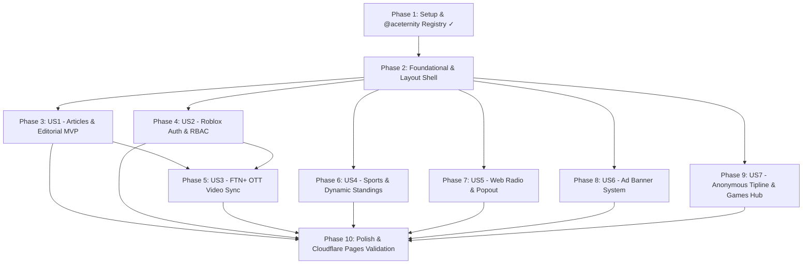

# Tasks: FTN Media Group Platform

**Feature Branch**: `001-ftn-media-platform` | **Date**: 2026-08-18 | **Spec**: [spec.md](./spec.md) | **Plan**: [plan.md](./plan.md)

---

## Phase 1: Setup (Shared Infrastructure & Foundation)

**Purpose**: Project bootstrapping, dependency configuration, and shadcn / Aceternity registry setup.

- [X] T001 Initialize Next.js 14+ project with TypeScript, Tailwind CSS, App Router, and ESLint in repository root
- [X] T002 Install core UI and edge dependencies (`framer-motion`, `clsx`, `tailwind-merge`, `lucide-react`, `@tabler/icons-react`, `drizzle-orm`, `drizzle-kit`, `@cloudflare/next-on-pages`, `wrangler`) in `package.json`
- [X] T003 Initialize shadcn UI configuration and configure `"@aceternity": "https://ui.aceternity.com/registry/{name}.json"` registry in `components.json`
- [X] T004 [P] Configure Cloudflare Pages, D1 database binding (`DB`), and KV cache binding (`CACHE`) in `wrangler.toml`
- [X] T005 [P] Configure Drizzle ORM SQLite dialect and migration settings in `drizzle.config.ts`
- [X] T006 [P] Configure Tailwind CSS theme and custom animation utilities in `tailwind.config.ts`

---

## Phase 2: Foundational (Blocking Prerequisites)

**Purpose**: Database schema, authentication utilities, RBAC gates, and global layout shell that MUST be completed before user stories.

- [X] T007 Define complete Cloudflare D1 relational database schema with Drizzle ORM in `db/schema.ts`
- [X] T008 [P] Implement Cloudflare D1 client connection helper in `db/index.ts`
- [X] T009 [P] Implement shared utility functions (`cn`, date formatters, slugify) in `lib/utils.ts`
- [X] T010 [P] Implement Roblox OAuth2 token exchange and JWT session helpers in `lib/auth.ts`
- [X] T011 [P] Implement RBAC division permission verification gates in `lib/rbac.ts`
- [X] T012 Assemble global root layout with Tailwind styles, typography, and viewport structure in `app/layout.tsx`
- [X] T013 Assemble global Navigation Bar using `@aceternity/navbar-menu` with prominent FTN+ link in `components/layout/navbar.tsx`
- [X] T014 [P] Assemble global Footer component with secondary navigation links in `components/layout/footer.tsx`
- [X] T015 Assemble persistent Audio Player Dock container widget using `@aceternity/hover-border-gradient` in `components/layout/audio-player-dock.tsx`
- [X] T016 Build public Homepage shell layout composing `@aceternity/bento-grid` breaking news, `@aceternity/infinite-moving-cards` ticker, and featured cards in `app/(public)/page.tsx`

**Checkpoint**: Foundation ready. `components.json` configured with `@aceternity`, D1 schema ready, global layout and navigation operational.

---

## Phase 3: User Story 1 - Core News & Editorial Publishing (Priority: P1) 🎯 MVP

**Goal**: Visitors can browse and read categorized news articles; authenticated users can comment; Digital Publishing staff can draft and publish articles with rich text.

**Independent Test**: Create and publish a rich-text article via `/admin/articles`, view it publicly on `/articles/[slug]`, and submit a comment while logged in.

- [X] T017 [P] [US1] Implement article and comment database CRUD operations in `lib/articles.ts`
- [X] T018 [P] [US1] Implement public article list and category filter API route in `app/api/articles/route.ts`
- [X] T019 [P] [US1] Implement single article detail, edit, and deletion API route in `app/api/articles/[slug]/route.ts`
- [X] T020 [P] [US1] Implement article comment submission and list API route in `app/api/articles/[slug]/comments/route.ts`
- [X] T021 [US1] Build rich text editorial authoring component with formatting and image embedding in `components/editor/rich-text-editor.tsx`
- [X] T022 [P] [US1] Build news article card and grid components using `@aceternity/direction-aware-hover` and `@aceternity/bento-grid` in `components/articles/article-card.tsx`
- [X] T023 [US1] Build public articles index and category filter page in `app/(public)/articles/page.tsx`
- [X] T024 [US1] Build public article reading page with `@aceternity/tracing-beam` and `@aceternity/text-generate-effect` in `app/(public)/articles/[slug]/page.tsx`
- [X] T025 [US1] Build Digital Publishing Division editorial management console in `app/(admin)/admin/articles/page.tsx`

**Checkpoint**: User Story 1 complete. Full news publication and reader commenting is functional independently.

---

## Phase 4: User Story 2 - Roblox Authentication & Role-Based Access Control (Priority: P1)

**Goal**: Users log in via Roblox OAuth2; root admin `alphaze1` is auto-seeded; Managers and Root Admins assign division roles to staff.

**Independent Test**: Sign in with Roblox account, verify session payload, log in as `alphaze1`, and assign division roles to other users in `/admin/roles`.

- [X] T026 [P] [US2] Implement Roblox OAuth2 authorization URL generator and callback handler in `app/api/auth/roblox/route.ts` and `app/api/auth/callback/route.ts`
- [X] T027 [P] [US2] Implement session verification and logout API routes in `app/api/auth/session/route.ts` and `app/api/auth/logout/route.ts`
- [X] T028 [P] [US2] Implement user listing and role delegation API routes in `app/api/admin/users/route.ts` and `app/api/admin/roles/route.ts`
- [X] T029 [US2] Implement superuser seeding logic ensuring `alphaze1` is granted `site_admin` on first login in `lib/auth.ts`
- [X] T030 [US2] Build user authentication status button and profile popover component in `components/layout/auth-button.tsx`
- [X] T031 [US2] Build Admin role management and staff delegation console in `app/(admin)/admin/roles/page.tsx`
- [X] T032 [US2] Build Admin central dashboard with division quick-access links in `app/(admin)/admin/page.tsx`

**Checkpoint**: User Story 2 complete. Authentication and role-based permissions protect administrative consoles.

---

## Phase 5: User Story 3 - FTN+ OTT Video & Livestream Streaming Hub (Priority: P2)

**Goal**: Immersive full-page dark-mode OTT streaming platform automatically ingesting YouTube videos/livestreams and providing user watchlists.

**Independent Test**: Trigger YouTube sync, navigate to `/plus`, watch embedded broadcast, and save video to `/plus/watchlist`.

- [X] T033 [P] [US3] Implement YouTube Data API v3 channel polling and video ingestion client in `lib/youtube.ts`
- [X] T034 [P] [US3] Implement automated YouTube sync API route with KV caching in `app/api/sync/youtube/route.ts`
- [X] T035 [P] [US3] Implement FTN+ video listing and category filter API route in `app/api/plus/videos/route.ts`
- [X] T036 [P] [US3] Implement user watchlist retrieval and toggle API route in `app/api/plus/watchlist/route.ts`
- [X] T037 [US3] Assemble FTN+ Hero Spotlight component using `@aceternity/spotlight` and `@aceternity/moving-border` in `components/ott/hero-spotlight.tsx`
- [X] T038 [P] [US3] Assemble horizontal video carousel row component using `@aceternity/focus-cards` in `components/ott/video-carousel.tsx`
- [X] T039 [P] [US3] Build embedded YouTube player theater component with `@aceternity/background-gradient` in `components/ott/video-player.tsx`
- [X] T040 [US3] Build full-page dark-mode FTN+ streaming hub page in `app/(ott)/plus/page.tsx`
- [X] T041 [US3] Build video playback theater page in `app/(ott)/plus/watch/[id]/page.tsx`
- [X] T042 [US3] Build user saved watchlist page in `app/(ott)/plus/watchlist/page.tsx`

**Checkpoint**: User Story 3 complete. FTN+ automated OTT streaming and watchlists are fully functional.

---

## Phase 6: User Story 4 - FTN Sports Hub & Standings Engine (Priority: P2)

**Goal**: Sports fans view match/race schedules, results, and automatically computed standings; Sports Division staff manage leagues and enter scores.

**Independent Test**: Create a league with custom point rules in `/admin/sports`, add a fixture, submit score, and verify public standings recalculation on `/sports`.

- [X] T043 [P] [US4] Implement sports scoring rule calculation and dynamic standings engine in `lib/sports.ts`
- [X] T044 [P] [US4] Implement sports league creation and list API route in `app/api/sports/leagues/route.ts`
- [X] T045 [P] [US4] Implement fixtures schedule and score recording API route in `app/api/sports/fixtures/route.ts`
- [X] T046 [P] [US4] Implement calculated standings query API route in `app/api/sports/standings/route.ts`
- [X] T047 [US4] Build dynamic championship standings table component using `@aceternity/card-spotlight` in `components/sports/standings-table.tsx`
- [X] T048 [P] [US4] Build match/race fixture schedule with `@aceternity/timeline` and featured match cards with `@aceternity/wobble-card` in `components/sports/fixture-card.tsx`
- [X] T049 [US4] Build public FTN Sports hub page with `@aceternity/tabs` switching between Leagues, Calendar, and Standings in `app/(public)/sports/page.tsx`
- [X] T050 [US4] Build dedicated single league standings and fixtures page in `app/(public)/sports/[leagueId]/page.tsx`
- [X] T051 [US4] Build Sports Division administration console for leagues, scoring, and score entry in `app/(admin)/admin/sports/page.tsx`

**Checkpoint**: User Story 4 complete. Sports fixtures, dynamic scoring rules, and standings updates are operational.

---

## Phase 7: User Story 5 - FTN Radio Web Player, Schedule & Popout (Priority: P3)

**Goal**: Visitors listen to 24/7 Icecast web radio via persistent player widget, view timetable on dedicated page, or pop out player; Broadcast staff manage schedule.

**Independent Test**: Play live stream in persistent widget, navigate pages without interruption, open popout player, and update show timetable in `/admin/radio`.

- [X] T052 [P] [US5] Implement Icecast stream status and metadata parser with KV cache in `lib/radio.ts`
- [X] T053 [P] [US5] Implement Icecast live metadata proxy API route in `app/api/radio/status/route.ts`
- [X] T054 [P] [US5] Implement radio show timetable CRUD API route in `app/api/radio/schedule/route.ts`
- [X] T055 [US5] Build persistent HTML5 audio stream player with `@aceternity/hover-border-gradient` in `components/layout/audio-player-dock.tsx`
- [X] T056 [US5] Build dedicated FTN Radio hub page with `@aceternity/vortex` and timetable in `app/(public)/radio/page.tsx`
- [X] T057 [US5] Build standalone detachable popout player window in `app/(public)/radio/popout/page.tsx`
- [X] T058 [US5] Build Broadcast Division radio show schedule management console in `app/(admin)/admin/radio/page.tsx`

**Checkpoint**: User Story 5 complete. Continuous audio streaming, popout mode, and timetable management are working.

---

## Phase 8: User Story 6 - Advertising Banner Management System (Priority: P3)

**Goal**: Banners are served in designated zones; Commercial Division staff manage ad creatives, links, and schedules.

**Independent Test**: Create active ad campaign in `/admin/ads`, verify its appearance in page banner slots, and click banner to test link redirect and click count.

- [X] T059 [P] [US6] Implement ad rotation selection and impression/click tracking API routes in `app/api/ads/route.ts` and `app/api/ads/[id]/click/route.ts`
- [X] T060 [P] [US6] Implement ad campaign CRUD API route in `app/api/admin/ads/route.ts`
- [X] T061 [US6] Build dynamic Ad Banner Zone wrapper component in `components/ads/banner-zone.tsx`
- [X] T062 [US6] Build Advertising & Commercial Division campaign management dashboard in `app/(admin)/admin/ads/page.tsx`

**Checkpoint**: User Story 6 complete. Banner ad rotation, tracking, and campaign management are active.

---

## Phase 9: User Story 7 - Anonymous Tipline & Extensible Games Hub (Priority: P4)

**Goal**: Confidential anonymous news tips submitted without identity tracking; clean extensible placeholder hub ready for future games.

**Independent Test**: Submit tip on `/tips`, verify receipt in `/admin/tips` with zero visitor data logged; verify `/games` displays clean placeholder catalog.

- [X] T063 [P] [US7] Implement anonymous tip submission API route (zero IP/cookie tracking) in `app/api/tips/route.ts`
- [X] T064 [P] [US7] Implement editorial tip review API route in `app/api/admin/tips/route.ts`
- [X] T065 [US7] Build confidential anonymous tipline submission page in `app/(public)/tips/page.tsx`
- [X] T066 [US7] Build editorial tip inbox and review console in `app/(admin)/admin/tips/page.tsx`
- [X] T067 [US7] Build extensible Games hub placeholder catalog layout in `app/(public)/games/page.tsx`

**Checkpoint**: User Story 7 complete. Anonymous tipline and games hub routing are established.

---

## Phase 10: Polish & Cross-Cutting Concerns

**Purpose**: Constitutional compliance check, edge deployment build validation, and end-to-end verification.

- [X] T068 Audit all UI components and pages to ensure 100% compliance with Project Constitution (zero emojis in nav/headers/buttons, zero meta-labels in parentheses, strict Aceternity Lego assembly)
- [X] T069 [P] Configure Cloudflare Pages build script with `@cloudflare/next-on-pages` and verify successful edge build
- [X] T070 [P] Optimize asset caching headers and image loading in Next.js configuration
- [X] T071 Run full end-to-end verification walkthrough following `quickstart.md` scenarios

---

## Dependencies & Execution Order

### Parallel Opportunities

- **Phase 1 (Setup)**: `T004`, `T005`, `T006` completed.
- **Phase 2 (Foundational)**: `T008`, `T009`, `T010`, `T011`, `T014` can run concurrently.
- **User Stories**: Once Phase 2 completes, user stories can be developed independently:
  - Developer A: User Story 1 (Articles & Publishing)
  - Developer B: User Story 2 (Roblox Auth & RBAC)
  - Developer C: User Story 4 (Sports Engine) or User Story 5 (Web Radio)
